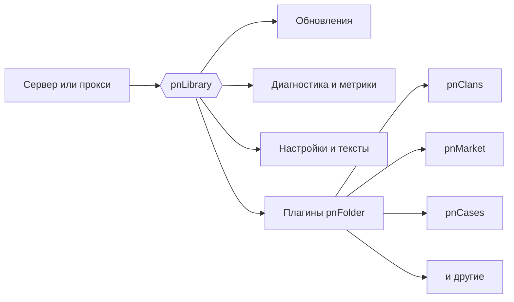

<h3>Ставишь один файл в <code>plugins</code>, настраиваешь в игре или в конфиге, обновляешь через pnLibrary.</h3>

<a href="#-плагины">🧩 Плагины</a> ·
<a href="#-pnlibrary">📦 pnLibrary</a> ·
<a href="#-быстрый-старт">🚀 Быстрый старт</a> ·
<a href="#-поддержка-и-сообщество">💬 Поддержка</a>

---

## 🧩 Плагины

### 🏰 Игровой процесс и PvP

| | Плагин | Что делает | Платформа |
|:-:|---|---|---|
| ⚔️ | [**pnClans**](https://github.com/pnFolder/pnClans)    | Кланы: роли, казна, дома, склад, прокачка, PvP и клановый чат в одном меню | Paper |
| 🎁 | [**pnCases**](https://github.com/pnFolder/pnCases)    | Кейсы с анимацией открытия, ключами и настройкой прямо в игре | Paper |
| 👻 | [**pnSouls**](https://github.com/pnFolder/pnSouls)    | Души-спутники: коллекция и призыв кликом | Paper |
| 💎 | [**pnRelics**](https://github.com/pnFolder/pnRelics)    | Настраиваемые руны и предметы с бонусами | Paper |
| 🛡️ | [**pnRelog**](https://github.com/pnFolder/pnRelog)    | Combat-tag и защита от выхода из боя | Paper, Purpur, Folia |

### 💰 Экономика и обмен

| | Плагин | Что делает | Платформа |
|:-:|---|---|---|
| 🛒 | [**pnMarket**](https://github.com/pnFolder/pnMarket)    | GUI-аукцион: несколько валют, комиссии, наборы, настраиваемый интерфейс | Paper |
| 🤝 | [**pnTrades**](https://github.com/pnFolder/pnTrades)    | Безопасный обмен предметами между игроками через GUI | Paper, Purpur |

### 🛠️ Сервер и модерация

| | Плагин | Что делает | Платформа |
|:-:|---|---|---|
| 🔨 | [**pnBans**](https://github.com/pnFolder/pnBans)    | Баны, муты, предупреждения, история нарушений | Paper |
| 💬 | [**pnChat**](https://github.com/pnFolder/pnChat)    | Сообщения рядом и важные для всех, настройка поведения чата | Paper |
| 🎲 | [**pnRtp**](https://github.com/pnFolder/pnRtp)    | Случайная телепортация игроков | Paper |

### 🌐 Сеть: прокси

| | Плагин | Что делает | Платформа |
|:-:|---|---|---|
| 🔐 | [**pnAuth**](https://github.com/pnFolder/pnAuth)    | Авторизация: регистрация, вход, встроенный PicoLimbo | BungeeCord, Velocity |
| 🤖 | [**pnCaptcha**](https://github.com/pnFolder/pnCaptcha)    | 3D CAPTCHA-шлюз перед входом на сервер | Velocity |

## 📦 pnLibrary

**[pnLibrary](https://github.com/pnFolder/pnLibrary)** — общая библиотека для **Bukkit, Paper, Folia, BungeeCord и Velocity**. Её ставят один раз на сервер, а все плагины используют общий рантайм: обновления, диагностику, метрики, настройки и сообщения об ошибках.

## 🚀 Быстрый старт

1. **Скачайте** нужный плагин во вкладке *Releases* его репозитория.
2. **Положите** файл в папку `plugins` и перезапустите сервер.
3. **Настройте** плагин в игре или в `config.yml`. Если нужна pnLibrary, плагин подскажет, как её поставить.

## 💬 Поддержка и сообщество

| | |
|:-:|---|
| 🆘 | помощь, если плагин сломался или не запускается |
| 📰 | новости и обновления плагинов |
| 💡 | идеи и пожелания: что добавить или исправить |
| 🚀 | анонсы новых плагинов |

> **Нашли ошибку?** Откройте issue в репозитории нужного плагина и приложите **лог запуска** и **версию сервера**.

