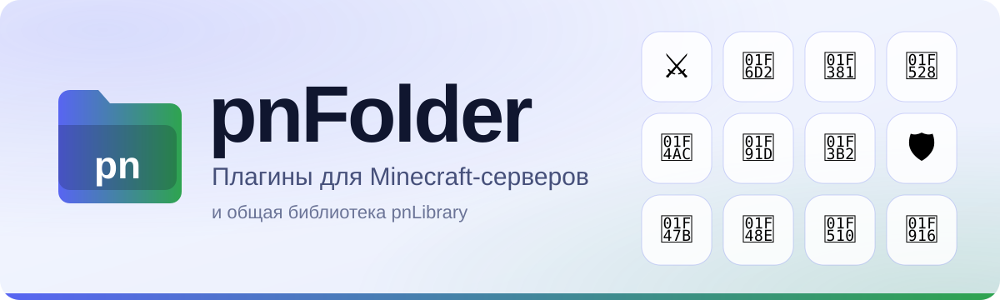
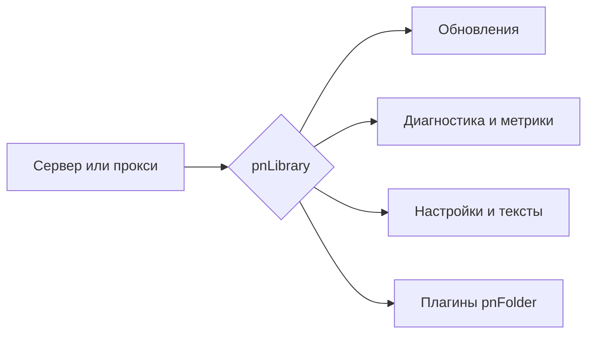

<picture>
  <source media="(prefers-color-scheme: dark)" srcset="https://raw.githubusercontent.com/pnFolder/.github/main/profile/hero-dark.svg">
  
</picture>

 

  

**Ставишь один файл в `plugins`, настраиваешь в игре или в конфиге, обновляешь через pnLibrary.**

 

[Плагины](#плагины) &nbsp;·&nbsp; [pnLibrary](#pnlibrary) &nbsp;·&nbsp; [Быстрый старт](#быстрый-старт) &nbsp;·&nbsp; [Поддержка](#поддержка-и-сообщество)

## Плагины

<table>
<tr>
<td width="33%" valign="top" align="center">

<h3>⚔️ <a href="https://github.com/pnFolder/pnClans">pnClans</a></h3>

Кланы: роли, казна, дома, склад, прокачка, PvP и клановый чат в одном меню

Paper 

</td>
<td width="33%" valign="top" align="center">

<h3>🛒 <a href="https://github.com/pnFolder/pnMarket">pnMarket</a></h3>

GUI-аукцион: несколько валют, комиссии, наборы, свой интерфейс

Paper 

</td>
<td width="33%" valign="top" align="center">

<h3>🎁 <a href="https://github.com/pnFolder/pnCases">pnCases</a></h3>

Кейсы с анимацией открытия, ключами и настройкой прямо в игре

Paper 

</td>
</tr>
<tr>
<td width="33%" valign="top" align="center">

<h3>🔨 <a href="https://github.com/pnFolder/pnBans">pnBans</a></h3>

Баны, муты, предупреждения и история нарушений

Paper 

</td>
<td width="33%" valign="top" align="center">

<h3>💬 <a href="https://github.com/pnFolder/pnChat">pnChat</a></h3>

Сообщения рядом и важные для всех, настройка поведения чата

Paper 

</td>
<td width="33%" valign="top" align="center">

<h3>🤝 <a href="https://github.com/pnFolder/pnTrades">pnTrades</a></h3>

Безопасный обмен предметами между игроками через GUI

Paper · Purpur 

</td>
</tr>
<tr>
<td width="33%" valign="top" align="center">

<h3>🎲 <a href="https://github.com/pnFolder/pnRtp">pnRtp</a></h3>

Случайная телепортация игроков

Paper 

</td>
<td width="33%" valign="top" align="center">

<h3>🛡️ <a href="https://github.com/pnFolder/pnRelog">pnRelog</a></h3>

Combat-tag и защита от выхода из боя

Paper · Purpur · Folia 

</td>
<td width="33%" valign="top" align="center">

<h3>👻 <a href="https://github.com/pnFolder/pnSouls">pnSouls</a></h3>

Души-спутники: коллекция и призыв кликом

Paper 

</td>
</tr>
<tr>
<td width="33%" valign="top" align="center">

<h3>💎 <a href="https://github.com/pnFolder/pnRelics">pnRelics</a></h3>

Настраиваемые руны и предметы с бонусами

Paper 

</td>
<td width="33%" valign="top" align="center">

<h3>🔐 <a href="https://github.com/pnFolder/pnAuth">pnAuth</a></h3>

Авторизация: регистрация, вход, встроенный PicoLimbo

BungeeCord · Velocity 

</td>
<td width="33%" valign="top" align="center">

<h3>🤖 <a href="https://github.com/pnFolder/pnCaptcha">pnCaptcha</a></h3>

3D CAPTCHA-шлюз перед входом на сервер

Velocity 

</td>
</tr>
</table>

## pnLibrary

**[pnLibrary](https://github.com/pnFolder/pnLibrary)** — общая библиотека для **Bukkit, Paper, Folia, BungeeCord и Velocity**. Её ставят один раз на сервер, а все плагины используют общий рантайм: обновления, диагностику, метрики, настройки и сообщения об ошибках.

## Быстрый старт

<table>
<tr>
<td width="33%" valign="top" align="center">

<h3>1️⃣ Скачайте</h3>

Нужный плагин во вкладке <b>Releases</b> его репозитория.

</td>
<td width="33%" valign="top" align="center">

<h3>2️⃣ Установите</h3>

Положите файл в папку <code>plugins</code> и перезапустите сервер.

</td>
<td width="33%" valign="top" align="center">

<h3>3️⃣ Настройте</h3>

В игре или в <code>config.yml</code>. Если нужна pnLibrary, плагин подскажет, как её поставить.

</td>
</tr>
</table>

## Поддержка и сообщество

🆘 помощь, если плагин сломался &nbsp;·&nbsp; 📰 новости и обновления &nbsp;·&nbsp; 💡 идеи и пожелания &nbsp;·&nbsp; 🚀 анонсы новых плагинов

> **Нашли ошибку?** Откройте issue в репозитории нужного плагина и приложите **лог запуска** и **версию сервера**.
